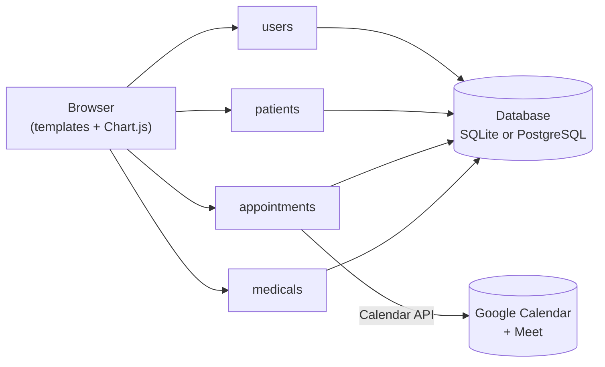
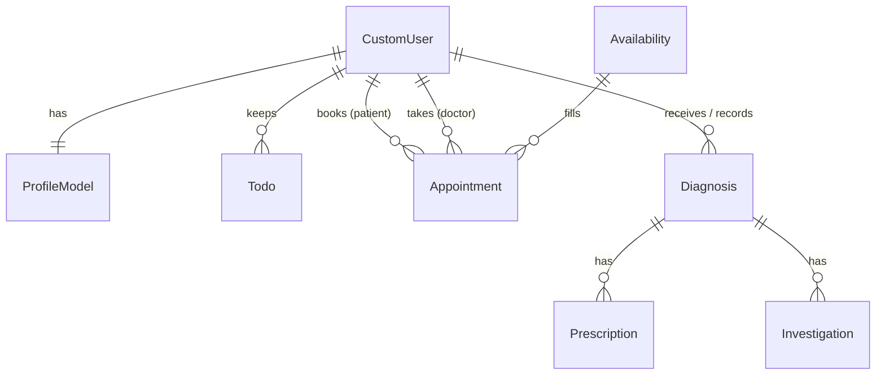

# Architecture

The system is a single Django 5 project, `HMS`, split into four apps. Pages are rendered on the server with Django templates styled with Tailwind CSS, and the dashboards load their chart data from small JSON endpoints that Chart.js draws in the browser.

| App | What it owns |
|---|---|
| `users` | The custom user model (email sign-in, profile ID), profiles with next-of-kin details and speciality, sign-in, registration and the doctor dashboard |
| `patients` | The patient dashboard, the staff patient list, and personal activity lists |
| `appointments` | Vitals and triage at booking, doctors' consulting hours, appointments and the Google Meet integration |
| `medicals` | Diagnoses, prescriptions, investigations and the medical record views |

## Data model

Everyone, patient or staff, is a `CustomUser`. A one-to-one `ProfileModel` holds the personal and clinical profile. Clinical records point at two users, the patient and the doctor, and prescriptions and investigations hang off the diagnosis they belong to.

| Model | Key fields |
|---|---|
| `CustomUser` | email (used to sign in), `profile_id` (five digits), name, contact, date of birth, sex |
| `ProfileModel` | profile picture, region, religion, marital status, occupation, speciality (for doctors), triage level, next-of-kin details |
| `BookPatient` | patient ID, temperature, blood pressure, triage, comments, time recorded |
| `Availability` | doctor ID, day of the week, time, in person or virtual |
| `Appointment` | doctor, patient, availability slot, comments, Google Meet link |
| `Diagnosis` | patient, doctor, diagnosis, acute or chronic |
| `Prescription` | diagnosis, medicine, strength, dose, frequency, duration, quantity, instructions |
| `Investigation` | diagnosis, test, unit, referral facility, reason |
| `Todo` | owner, task, deadline, completed |

Clinical fields use fixed choices (for example ten common diagnoses, ten medicines, four strengths and the standard OD/BID/TID/QID doses), which keeps records consistent and makes them easy to count for the charts.

## Charts

Two JSON endpoints feed the dashboards:

- `GET /chart/` returns diagnosis counts across the hospital and a count of men, women and children, for the doctor dashboard.
- `GET /patients/chart/` returns diagnosis counts and the signed-in patient's temperature, systolic and diastolic pressure for the last six days, for the patient dashboard.
