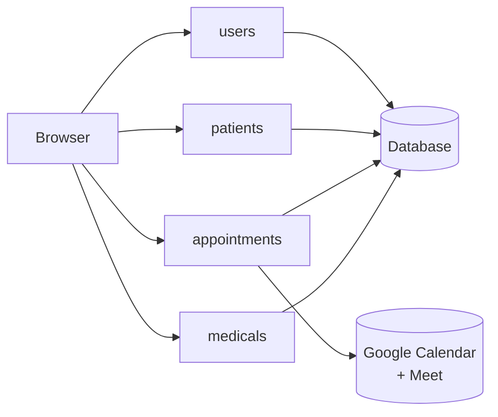
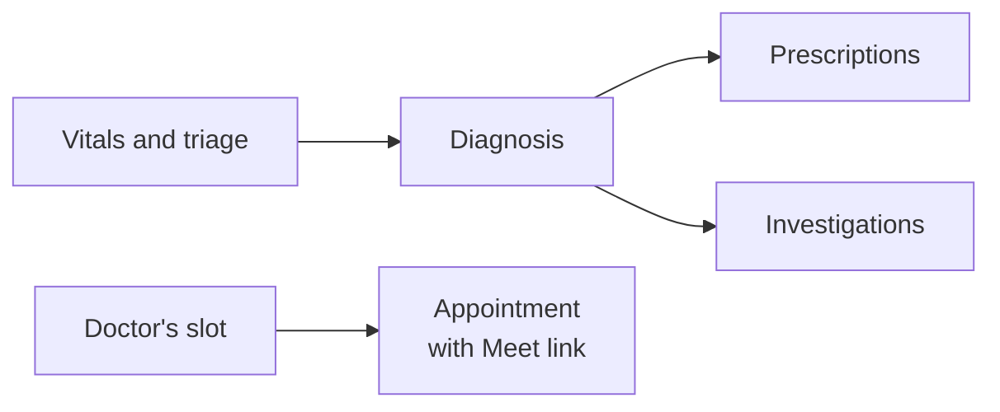

# Architecture

The system is a single Django project split into four apps. Pages are rendered on the server and styled with Tailwind CSS, and the dashboards draw their charts in the browser with Chart.js.

| App | What it covers |
|---|---|
| `users` | Accounts, profiles, sign-in and the doctor dashboard |
| `patients` | The patient dashboard, the staff patient list and personal activity lists |
| `appointments` | Vitals and triage, doctors' consulting hours, appointments and Google Meet |
| `medicals` | Diagnoses, prescriptions, investigations and medical records |

## How the records fit together

Everyone, patient or staff, has one account with a profile. A visit starts with vitals and a triage level. The doctor's diagnosis is the anchor for the rest: prescriptions and investigations are attached to it, so a patient's history reads as a series of diagnoses, each with what was prescribed and what was tested.

Clinical entries use fixed lists (common diagnoses, medicines, strengths and doses) rather than free text, which keeps records consistent and easy to chart.
