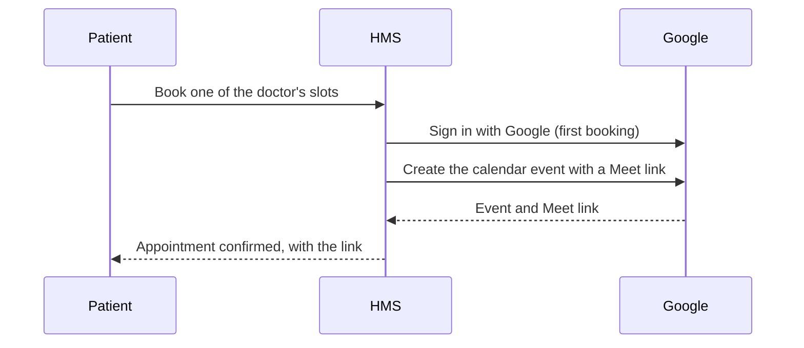

# Telemedicine

When a patient books one of a doctor's slots, the system creates a Google Calendar event for the next time that slot comes round, invites both the patient and the doctor, and attaches a Google Meet link. The link appears on both of their sessions pages.

## Setting it up

To use telemedicine on your own copy, create a Google Cloud project with the Google Calendar API enabled and an OAuth client for a web application. Save the client file where the [getting started guide]() describes, and add your site's sign-in callback to the OAuth client. Everything else in the system works without it.
