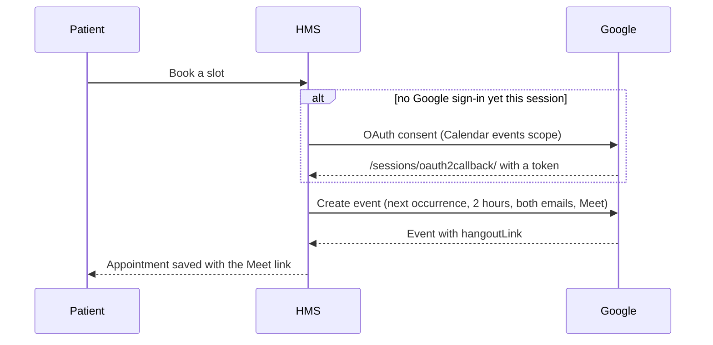

# Telemedicine

When a patient books one of a doctor's slots, the system creates a Google Calendar event for the next occurrence of that slot, invites both the patient and the doctor, and asks Google to attach a Meet conference. The Meet link is saved on the appointment and shown on both of their sessions pages.



## Setting it up

1. In the [Google Cloud console](https://console.cloud.google.com/), create a project and enable the **Google Calendar API**.
2. Create an **OAuth client ID** and add this redirect URI (and your production equivalent):
   ```
   http://localhost:8000/sessions/oauth2callback/
   ```
3. Download the client's JSON file and save it as `HMS/secrets/credentials.json`. The `secrets/` folder is in `.gitignore`, so it won't be committed.

The app asks only for the `calendar.events` scope. The token is kept in the user's session, so each person signs in to Google once per session.

## Things to know

- Events are created in UTC and last two hours.
- A slot is a day of the week and a time. If today's slot has already passed, the event goes into next week.
- `OAUTHLIB_INSECURE_TRANSPORT` is switched on in the OAuth views so the flow works over plain HTTP during local development. Serve the site over HTTPS in production; see [Deployment]().
