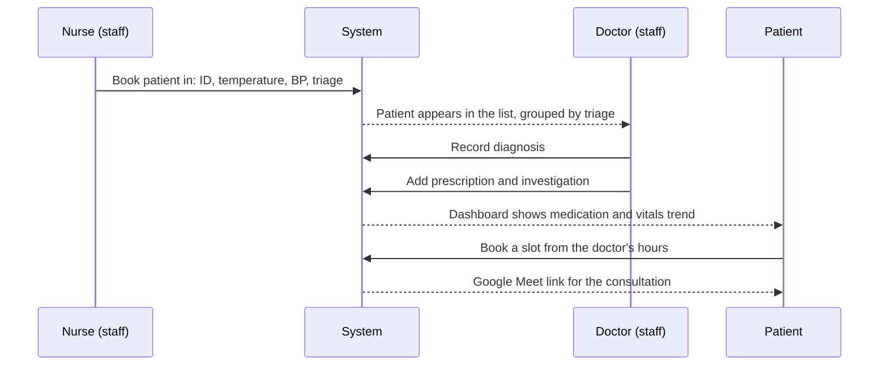

# Workflows

There are three kinds of account. **Patients** are ordinary accounts. **Clinical staff** are accounts with Django's staff flag, which covers both nurses and doctors. **Administrators** are superusers who manage everything through the Django admin.

## A visit, end to end

## Clinical staff

- **Book a patient in** at *Book patient*, using the patient's profile ID: temperature, blood pressure (as `systolic/diastolic`), triage level and comments.
- **See the patient list**, ordered by each patient's most recent visit and grouped into critical, severe and normal.
- **Open a patient's attendance page** to record a diagnosis, then add prescriptions and investigations to it.
- **Browse medical records**, either the full history or a single record.
- **Set consulting hours** from the profile page: a day of the week, a time, and whether it's in person or virtual.
- **Use the doctor dashboard** for upcoming appointments, the patients they've diagnosed, their activity list, and hospital-wide charts.

## Patients

- **Register** and complete their profile, including next-of-kin details.
- **Follow their care** on the dashboard: current medication with dose and duration, the doctors who've seen them, upcoming appointments, and a chart of their recent vitals.
- **Find a doctor** on the appointment page, filtering by speciality, and **book** one of their open slots. Booking creates the Google Meet link; see [Telemedicine]().
- **Cancel** an appointment from the sessions page.
- **Keep an activity list** with deadlines; items past their deadline are cleared automatically.

## Housekeeping

Appointments are tied to a weekly slot, so when a sessions page is opened, any appointment whose slot has already passed is removed. The doctor or patient only ever sees what's still ahead.
